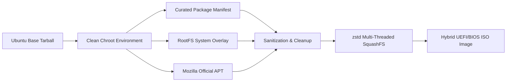

# Krubuntu 26.04.1 LTS (KDE Plasma Edition)

<p align="center">
  
</p>

<p align="center">
  <b>A Pure, Bloat-Free, Open-Source Linux Distribution Built on Ubuntu 26.04 LTS & KDE Plasma.</b><br>
  <i>Engineered using professional Infrastructure-as-Code (IaC) standards — No Cubic, No Bloat, No Compromises.</i>
</p>

<p align="center">
  <a href="https://github.com/krinry/krubuntu/actions/workflows/build-and-release.yml"></a>
  <a href="https://github.com/krinry/krubuntu/releases"></a>
  
  
  
  
</p>

---

## 📖 Table of Contents
- [Overview](#-overview)
- [Key Features](#-key-features)
- [System Architecture](#-system-architecture)
- [Hardware Enablement](#-hardware-enablement)
- [Software & Packaging Policy](#-software--packaging-policy)
- [Quick Start: Build & Test](#-quick-start-build--test)
- [Documentation Guides](#-documentation-guides)
- [Contributing](#-contributing)
- [License](#-license)

---

## 🌟 Overview

**Krubuntu** is an open-source Linux operating system designed for users who want the rock-solid hardware support and extensive software ecosystem of Ubuntu LTS, paired with the speed, beauty, and modern Wayland architecture of KDE Plasma — **completely free of bloatware, telemetry, and background overhead**.

Unlike ordinary remaster projects that rely on manual snapshot tools like Cubic, Krubuntu is built strictly from cryptographic root sources using clean, reproducible shell automation scripts on an ephemeral chroot pipeline.

---

## 🚀 Key Features

* **Ubuntu 26.04.1 LTS Minimal Core:** Pure Resolute Raccoon upstream base without unnecessary legacy daemons.
* **KDE Plasma 6 (Wayland-First):** Sleek, lightweight Breeze interface with 100% Wayland compositing, fractional display scaling, and fluid animations.
* **Modern Sound Architecture:** **PipeWire 1.6 + WirePlumber** out of the box with Intel Sound Open Firmware (`SOF`), ALSA UCM profiles, and Bluetooth LDAC/AptX/AAC codecs.
* **High-Throughput Network Engine:** **Google BBR** TCP congestion control pre-activated for ultra-low latency web browsing and maximum bandwidth saturation.
* **Adaptive Memory Management:**
  * **`systemd-zram-generator`:** In-RAM zstd swap engine providing 100% RAM expansion without physical disk thrashing.
  * **`earlyoom`:** Pop!_OS style freeze guard that terminates runaway memory leaks before the desktop locks up.
* **Day-to-Day Productivity Apps:**
  * **Browser:** Native **Mozilla Firefox** (`.deb`) directly from Mozilla's official signed APT repository (Zero Snap daemon overhead).
  * **PDF & Documents:** **Okular** universal document viewer.
  * **Media Playback:** **VLC** and **FFmpeg** with hardware VA-API video decode acceleration.
  * **Utilities:** Dolphin, Konsole, KWrite, Ark, Gwenview, Spectacle, and KDE Partition Manager.
* **Zero Bloatware:** No pre-installed games, no telemetry, no third-party trial software, no duplicate utilities.
* **User-Empowered Packaging:**
  * **Snap:** `snapd` is installed with Discover integration, but **disabled at boot by default** to preserve RAM and CPU cycles.
  * **Flatpak:** Flathub remote is pre-configured in a **disabled state**, allowing instant 1-click activation from KDE Discover Settings without terminal commands.
* **Modern Installer:** **Calamares 3.3+** with Krubuntu branding, automated partition erase option, and target rootfs cleanup.
* **Hybrid Bootloader:** UEFI (x86_64) and Legacy BIOS hybrid ISO compatible with NVMe, SATA SSD, and USB flash media.

---

## 🏗️ System Architecture

Krubuntu is built as Infrastructure-as-Code:



For the complete technical breakdown of the chroot lifecycle, memory subsystems, and kernel tuning, see [Architecture Documentation](docs/ARCHITECTURE.md).

---

## ⚡ Hardware Enablement

Krubuntu provides out-of-the-box support for modern and legacy PC hardware:

| Hardware | Support Level | Implementation |
| :--- | :--- | :--- |
| **Intel / AMD Laptops** | Full Native | PipeWire + `firmware-sof-signed` + ALSA UCM (`alsa-ucm-conf`) |
| **Display & GPU** | Vulkan 1.3 & VA-API | Mesa 24.x (`mesa-vulkan-drivers`), Intel VA-API (`intel-media-va-driver`) |
| **Wi-Fi 6 / 6E / 7** | Out of the Box | NetworkManager + Netplan delegation + `wpasupplicant` |
| **External USB / Disks** | Plug & Play | NTFS-3G (`ntfs-3g`), exFAT (`exfatprogs`), FAT32 (`dosfstools`) |
| **Power & Battery** | Dynamic Profiles | `power-profiles-daemon` with KDE battery applet integration |

For detailed hardware specifications, see [Hardware Enablement Guide](docs/HARDWARE_ENABLEMENT.md).

---

## 📦 Software & Packaging Policy

| Packaging Backend | Default State | How to Use / Toggle |
| :--- | :--- | :--- |
| **Native APT (.deb)** | Enabled (Primary) | `sudo apt install <package>` or Discover |
| **Mozilla Firefox (.deb)** | Enabled (Official Key) | Directly from Mozilla signing server |
| **Flatpak (Flathub)** | Pre-configured (Disabled) | 1-Click checkbox in **Discover Settings** |
| **Snap (Canonical)** | Pre-installed (Disabled at boot) | Discover Settings or `krubuntu-backend-manager` |

For complete rationale, pinning rules, and offline catalog details, read the [Package Policy Guide](docs/PACKAGE_POLICY.md).

---

## 🛠️ Quick Start: Build & Test

### 1. Build the ISO with Docker (Recommended)
You can build the ISO on any Linux distribution (Fedora, Arch, Debian, Ubuntu):
```bash
# Clone the repository
git clone https://github.com/krinry/krubuntu.git
cd krubuntu

# Build inside isolated Ubuntu 26.04 builder container
./build.sh --docker
```

### 2. Test in QEMU
Immediately verify the generated ISO with hardware-accelerated KVM virtualization, duplex audio, and virtual disk:
```bash
./build.sh --test
```

### 3. Verify Checksum
```bash
cd output
sha256sum -c Krubuntu-26.04.1-amd64.iso.sha256
```

---

## 📚 Documentation Guides

* [**Architecture & Engineering**](docs/ARCHITECTURE.md) - Deep dive into build pipeline, zRAM, BBR sysctl, and Calamares.
* [**Hardware Enablement**](docs/HARDWARE_ENABLEMENT.md) - Audio DSP, Vulkan, Wi-Fi 6/7, and power profiles.
* [**Package Management Policy**](docs/PACKAGE_POLICY.md) - Snap/Flatpak philosophy, Mozilla deb integration, and Discover.
* [**Installation & Setup Guide**](docs/INSTALLATION_GUIDE.md) - Flashing with Rufus/Etcher/Ventoy, BIOS settings, and dual-booting.
* [**Contributing Guide**](CONTRIBUTING.md) - Code standards, testing workflow, and pull request guidelines.

---

## 🤝 Contributing

Contributions are warmly welcomed! Please see [CONTRIBUTING.md](CONTRIBUTING.md) for full instructions on setting up your environment, running tests, and submitting pull requests.

---

## 📄 License

Krubuntu is open-source software licensed under the [GNU General Public License v3.0 (GPL-3.0)](LICENSE). Upstream components remain under their respective open-source licenses (Ubuntu, KDE, Linux Kernel, Mozilla).
