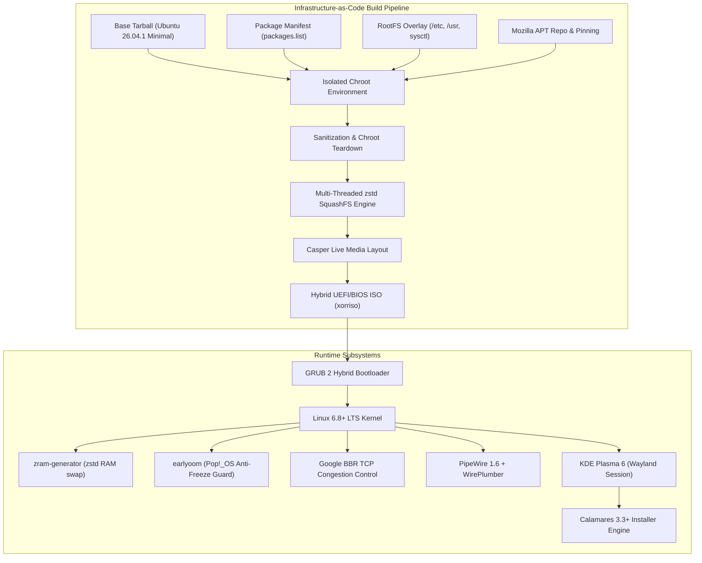
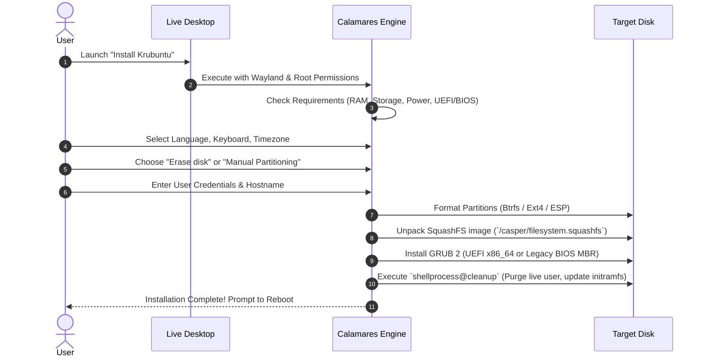

# Krubuntu Architecture & System Engineering

This document provides a technical deep-dive into the architectural foundations, build pipeline, memory optimization, network tuning, and installer subsystem of **Krubuntu 26.04.1 LTS (KDE Plasma Edition)**.



---

## 1. Core Engineering Philosophy

Traditional Linux remastering workflows frequently rely on graphical snapshot utilities such as Cubic. While convenient for quick experimentation, snapshot tools suffer from significant architectural limitations:
* **Host Contamination:** Host machine cache files, machine IDs, network leases, and user states inadvertently leak into the target live image.
* **Non-Deterministic Builds:** Point-and-click modifications lack auditability, automated regression testing, and version control.
* **Mount Leaks:** Unclean teardowns frequently cause virtual filesystem (`/proc`, `/sys`, `/dev`) lockups, leading to corrupted SquashFS images.

Krubuntu is engineered using a strict **Infrastructure-as-Code (IaC)** pipeline inspired by Linux Mint and Fedora:
1. **Deterministic Clean Room:** The build starts from an unmodified, cryptographic Ubuntu 26.04 Base archive (`ubuntu-base-26.04.1-base-amd64.tar.gz`).
2. **Ephemeral Chroot Isolation:** All software installation, user generation, and service configuration occur inside an isolated chroot with signal traps guaranteeing virtual filesystem unmounting on abort or exit.
3. **Multi-Stage Sanitization:** Prior to filesystem compression, all package caches, temporary files, D-Bus machine identifiers, log buffers, and bash histories are scrubbed.

---

## 2. Memory & Responsiveness Subsystem

Desktop responsiveness under intense memory pressure (e.g., modern web browsers, compiling code, virtual machines) is critical for a smooth daily driver experience. Krubuntu integrates three synergistic subsystems:

### 2.1 systemd-zram-generator
Rather than allocating a fixed, slow swap partition on physical storage, Krubuntu dynamically initializes a compressed RAM swap drive (`/dev/zram0`):
* **Algorithm:** `zstd` (high compression ratio with ultra-fast decompression throughput).
* **RAM Allocation:** 100% of physical RAM capacity is dynamically available to the zram pool without pre-allocating memory pages until actually needed.
* **Swap Priority:** `100` (guarantees that compressed in-RAM swap is always saturated before any secondary physical swap is touched).
* **Configuration:** `/etc/systemd/zram-generator.conf`

```ini
[zram0]
zram-size = min(ram, 4096) + max(ram - 4096, 0)
compression-algorithm = zstd
swap-priority = 100
```

### 2.2 earlyoom (Pop!_OS Freeze Guard)
The native Linux kernel OOM (Out-Of-Memory) killer activates only when memory and swap are completely exhausted, typically causing the entire desktop environment to lock up or freeze for several minutes while trashing swap pages.
* Krubuntu bundles **`earlyoom`**, running continuously in user-space.
* **Thresholds:** Checks available memory and free swap 10 times per second. If both available memory drops below **4%** and free swap drops below **2%**, `earlyoom` instantly sends `SIGTERM` (followed by `SIGKILL` after 1 second) to the highest memory-consuming process (e.g., an unresponsive browser tab or memory-leaking process).
* **Desktop Protection:** SDDM, KWin, PipeWire, and Systemd processes are explicitly protected from earlyoom termination.

### 2.3 Kernel Virtual Memory Tuning
Krubuntu tunes kernel virtual memory parameters via `/etc/sysctl.d/99-krubuntu-performance.conf`:

| Kernel Sysctl Parameter | Default Value | Krubuntu Value | Rationale |
| :--- | :--- | :--- | :--- |
| `vm.swappiness` | `60` | `180` | Aggressively swaps inactive anonymous memory pages into fast zstd zRAM, freeing uncompressed physical memory for active file caches. |
| `vm.vfs_cache_pressure` | `100` | `50` | Prioritizes directory entry (dentry) and inode caching in RAM, accelerating Dolphin file browsing and code navigation. |
| `vm.dirty_background_ratio` | `10` | `5` | Begins background flush of dirty memory pages to disk early, preventing large I/O stalls during sustained writes. |
| `vm.dirty_ratio` | `20` | `10` | Caps dirty writeback memory to prevent desktop UI jitter during heavy disk writes. |

---

## 3. High-Throughput Network Engine (Google BBR)

Krubuntu activates Google's **BBR (Bottleneck Bandwidth and RTT)** congestion control algorithm out-of-the-box.

Traditional TCP congestion control algorithms (like Cubic or Reno) interpret packet loss as congestion, leading to drastic throughput throttling on modern high-speed Wi-Fi 6/7, cellular, or long-distance networks.

BBR models the physical network path to dynamically measure both maximum bandwidth and minimum round-trip time:
```text
net.core.default_qdisc = fq
net.ipv4.tcp_congestion_control = bbr
```
* **Fair Queueing (`fq`):** Regulates packet pacing at the network interface layer, eliminating bufferbloat.
* **Low Latency:** Delivers significantly faster web browsing, smoother video streaming, and rapid download speeds under real-world packet jitter conditions.

---

## 4. Audio Subsystem (PipeWire 1.6 + WirePlumber)

Krubuntu completely replaces legacy PulseAudio and ALSA sound servers with a unified **PipeWire** architecture:
* **Session Management:** Governed by **WirePlumber 0.5+**, orchestrating dynamic endpoint routing, Bluetooth profile auto-switching, and hardware event handling.
* **DSP & Low-Latency Processing:** Real-time audio routing with sample-accurate synchronization suitable for pro-audio, gaming, and conferencing.
* **Firmware Integration:**
  * Intel Sound Open Firmware (`firmware-sof-signed`) support for modern 10th-14th+ Gen Core laptops.
  * ALSA Use Case Manager (`alsa-ucm-conf`) hardware topology profiles for digital microphone arrays, internal speaker amps, and headphone jack detection.
  * Universal Bluetooth audio via `libspa-0.2-bluetooth` supporting AAC, AptX, LDAC, and SBC-XQ high-definition codecs.

---

## 5. Calamares Modern Installer Architecture

Krubuntu utilizes **Calamares 3.3+** for all bare-metal and virtual installations:



### 5.1 Calamares Key Modules & Directives
* **`partition.conf`:** Configured with `initialPartitioningChoice: erase` so unpartitioned disks or empty drives are immediately recognized with a simple, safe default installation path.
* **`unpackfs.conf`:** Extracts `/casper/filesystem.squashfs` onto the target root partition.
* **`bootloader.conf`:** Detects UEFI vs. Legacy BIOS mode automatically, installing the appropriate GRUB 2 EFI executable or MBR stage.
* **`shellprocess_cleanup.conf`:** Removes live user artifacts (`/home/krubuntu`, SDDM autologin bypass, Desktop installer shortcut) on the installed target.

---

## 6. Build Engine & SquashFS Compression

Live media compilation performance is optimized via modern compression algorithms:
* **SquashFS Engine:** Multi-threaded `zstd` compression with `-Xcompression-level 15`.
* **Build Speed:** Compresses the 6.2 GB uncompressed root filesystem in **~25 seconds** (compared to 4.5+ minutes with legacy `xz`).
* **Boot Speed:** Boot-time decompression is up to 5x faster, drastically reducing live boot times on USB 2.0/3.0 flash drives.
* **Hybrid ISO Packaging:** Built using `grub-mkrescue` and `xorriso` with full El Torito boot catalog, EFI system partition, and MBR boot sector for universal compatibility across any x86_64 hardware.
