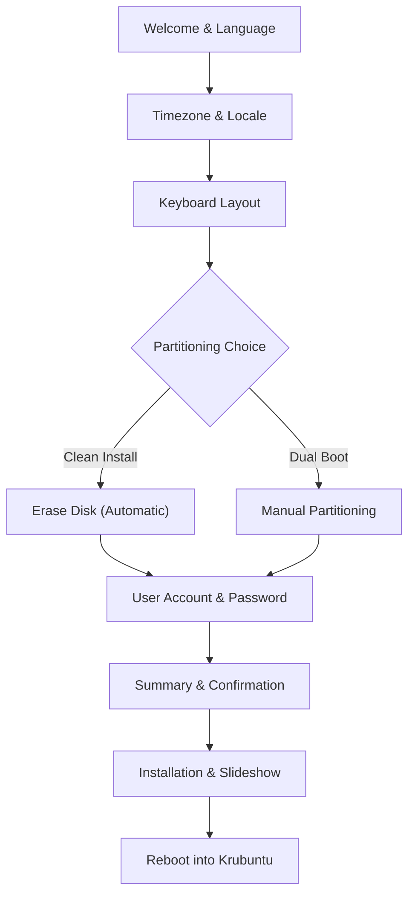

# Krubuntu Installation & Setup Guide

This guide provides complete instructions for downloading, verifying, flashing, and installing **Krubuntu 26.04.1 LTS (KDE Plasma Edition)** on bare-metal laptops, desktops, and virtual environments.

---

## 1. System Requirements

| Specification | Minimum Requirement | Recommended Specification |
| :--- | :--- | :--- |
| **Processor** | 64-bit dual-core x86_64 CPU (1.8 GHz+) | Quad-core 64-bit CPU (Intel Core i3/i5/i7/i9 or AMD Ryzen) |
| **RAM** | 2 GB physical RAM | 4 GB - 8 GB+ RAM |
| **Storage** | 20 GB available storage | 50 GB+ NVMe or SATA SSD |
| **Graphics** | 1024 x 768 resolution, Intel HD / AMD Radeon | 1920 x 1080+ resolution, Vulkan 1.3 capable GPU |
| **Media** | 4 GB+ USB flash drive for installation media | USB 3.0 / 3.1 / Type-C flash drive |

---

## 2. Download & Verify Integrity

Always verify the cryptographic integrity of your downloaded ISO before flashing to ensure it was not corrupted during transit.

### Linux / macOS:
```bash
# Place both the ISO and the .sha256 file in the same directory
sha256sum -c Krubuntu-26.04.1-amd64.iso.sha256
```
**Expected Output:**
```text
Krubuntu-26.04.1-amd64.iso: OK
```

### Windows (PowerShell):
```powershell
Get-FileHash -Algorithm SHA256 .\Krubuntu-26.04.1-amd64.iso
```
*Compare the resulting hash with the string in `Krubuntu-26.04.1-amd64.iso.sha256`.*

---

## 3. Creating Bootable USB Media

### Option A: Ventoy (Highly Recommended)
[Ventoy](https://www.ventoy.net/) is the easiest and most versatile multi-boot USB solution:
1. Install Ventoy onto your USB drive once.
2. Drag and drop `Krubuntu-26.04.1-amd64.iso` directly onto the USB drive like a regular file.
3. Boot your computer from the USB drive and select Krubuntu from the menu.

---

### Option B: BalenaEtcher (Windows, macOS, Linux)
1. Download and open [balenaEtcher](https://etcher.balena.io/).
2. Click **Flash from file** and select `Krubuntu-26.04.1-amd64.iso`.
3. Select your target USB drive.
4. Click **Flash!** and wait for verification to complete.

---

### Option C: Rufus (Windows)
1. Download [Rufus](https://rufus.ie/).
2. Select your USB drive under **Device**.
3. Click **SELECT** and choose `Krubuntu-26.04.1-amd64.iso`.
4. Partition scheme: **GPT** | Target system: **UEFI (non-CSM)**.
5. Click **START**. If prompted to write in *ISO Image mode* or *DD Image mode*, select **DD Image mode** for maximum hybrid bootloader compatibility.

---

### Option D: Linux Terminal (`dd`)
```bash
# Identify your USB drive device node (e.g. /dev/sdb)
lsblk

# Flash directly (replace /dev/sdX with your actual device - NOT a partition like /dev/sdX1)
sudo dd if=Krubuntu-26.04.1-amd64.iso of=/dev/sdX bs=4M status=progress conv=fsync
```

---

## 4. BIOS / UEFI Pre-Configuration

Before booting the USB drive:
1. **Disable Windows Fast Startup** *(Dual-Boot Only)*:
   * In Windows: Open Control Panel → Power Options → "Choose what the power buttons do" → Uncheck "Turn on fast startup".
   * *Why:* Fast Startup puts NTFS partitions into a locked hibernation state, preventing Linux from safely mounting them.
2. **Set SATA Controller to AHCI**:
   * Enter BIOS/UEFI settings (typically pressing `F2`, `F12`, `Del`, or `Esc` during power-on).
   * Ensure storage mode is set to **AHCI** (disable Intel RST / RAID).
3. **Secure Boot**:
   * For the initial install, disable Secure Boot in UEFI settings.
4. **Select Boot Device**:
   * Press your computer's Boot Menu key (`F12` for Dell/Lenovo, `F11` for MSI, `F9` for HP, `F8`/`F12` for Asus) and choose your UEFI USB drive.

---

## 5. Live Environment & Testing

Krubuntu boots directly into a live Wayland desktop session:
* **Audio Check:** Open the volume applet in the bottom right, play a video or sound to verify PipeWire output.
* **Wi-Fi Check:** Click the network icon in the system tray, select your Wi-Fi network, and enter the password.
* **Display Scaling:** Open System Settings → Display and Monitor to adjust resolution or fractional scaling.

---

## 6. Calamares Installation Walkthrough

When ready, double-click the **Install Krubuntu** icon on the desktop.



### Step 1: Language & Locale
Select your preferred display language. Calamares will set this as the default system language.

### Step 2: Timezone & Clock
Click your location on the world map to set your local timezone.

### Step 3: Keyboard Layout
Select your keyboard language and variant. Type in the test box to confirm special keys and accents.

### Step 4: Disk Partitioning
Calamares provides two intuitive modes:

#### Mode 1: Erase Disk (Recommended for Single-OS Machines)
* Select the target drive from the dropdown.
* Calamares automatically creates an EFI System Partition (`/boot/efi`) and a root partition (`/`) formatted as Ext4 or Btrfs.
* You can optionally select "Swap (with Hibernate)" or rely on Krubuntu's built-in zRAM generator.

#### Mode 2: Manual Partitioning (For Dual-Booting with Windows)
* Select your target drive.
* If dual-booting with Windows:
  1. Shrink an existing Windows NTFS data partition to create free space (at least 30 GB).
  2. Create a new partition from the free space:
     * **Mount Point:** `/` (root)
     * **Filesystem:** `ext4` or `btrfs`
  3. Locate your existing Windows EFI partition (typically 100MB - 500MB, FAT32):
     * Click **Edit**.
     * **Mount Point:** `/boot/efi`
     * **Do NOT format** this partition! This preserves the Windows Boot Manager alongside Krubuntu's GRUB 2.

### Step 5: User Account Setup
* Enter your full name, username, and computer hostname.
* Enter a strong password for your user account.
* You can optionally check "Log in automatically without asking for the password".

### Step 6: Confirmation & Installation
Review the installation summary. Once you click **Install Now**, Calamares formats the selected partitions, unpacks the system image, installs the hybrid bootloader, and removes live session accounts.

### Step 7: Finished!
When the progress bar reaches 100%, check the "Restart now" box and click **Done**. Unplug the USB drive when prompted and press Enter to boot into your new Krubuntu installation!

---

## 7. Post-Installation First Steps

### Update Software Packages
Open Konsole (`Ctrl+Alt+T`) and run:
```bash
sudo apt update && sudo apt upgrade -y
```

### Enable Flatpak Applications (Optional)
Open **Discover**, go to **Settings**, and tick the checkbox next to **Flathub**. You can now install Spotify, Steam, Discord, and thousands of other applications with one click.

### Install NVIDIA Proprietary Drivers (For NVIDIA GPU Users)
If you have an NVIDIA dedicated graphics card:
```bash
sudo ubuntu-drivers install
sudo reboot
```
